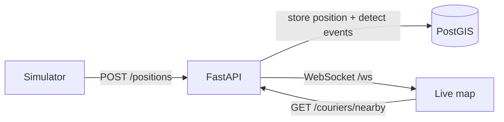

# geotrack

Live location tracking for deliveries, built on PostGIS.

Couriers send their position; the system stores it as an event, answers proximity queries ("who is within 2 km?", "who is nearest to this order?"), detects geofence and arrival events, and shows everything on a live map.

## Features
- Position ingestion API (FastAPI) with input validation
- Geospatial data model in PostgreSQL + PostGIS, with GiST spatial indexes
- Proximity queries: radius search and nearest available courier
- Geofences (polygons) with enter/leave events, and arrival detection at the order destination
- Real-time updates over WebSocket
- Live map (Leaflet) with zones, moving couriers, event feed and click-to-search by radius
- Movement simulator, so no real devices are needed
- Automated tests against a real PostGIS database

## How it works


1. A courier position arrives at `POST /positions` and is saved as a new row (positions are never updated, so the full history is kept).
2. In the same transaction, the new position is compared with the previous one to detect `entered_zone`, `left_zone` and `arrived_at_destination` events.
3. After the commit, the position and its events are pushed to every connected browser.

## Quick start
Requirements: Docker and Python 3.11+.

```
# 1. Database
cp .env.example .env
docker compose up -d

# 2. API
python -m venv .venv
.venv/Scripts/pip install -r requirements.txt        # Linux/Mac: .venv/bin/pip
.venv/Scripts/python -m uvicorn app.main:app --loop app.loop:selector_loop_factory

# 3. Simulator (in another terminal)
.venv/Scripts/python simulator/simulate.py --speed 60
```
Open http://localhost:8000/ for the live map and http://localhost:8000/docs for the interactive API docs.

The database listens on port 5434 (see `.env`). The custom `--loop` is only needed on Windows, where psycopg async does not work with the default event loop.

## API
| Method | Path | Description |
|---|---|---|
| POST | `/positions` | Store a courier position `{courier_id, lat, lon}` |
| GET | `/couriers/{id}/position` | Latest position of a courier |
| GET | `/couriers/nearby?lat=&lon=&radius=` | Couriers within `radius` meters (default 2000), nearest first |
| GET | `/orders/{id}/nearest-courier` | Nearest available courier to an order |
| POST | `/orders/{id}/assign` | Assign a pending order to a courier `{courier_id}` |
| GET | `/events?courier_id=&limit=` | Latest events |
| GET | `/zones` | Geofences as GeoJSON |
| GET | `/health` | Health check |
| WS | `/ws` | Live stream: a `snapshot`, then `position`, `event` and `courier_status` messages |

## Data model
- `couriers`: delivery people and their status (`available`, `busy`, `offline`)
- `orders`: delivery destinations as `GEOGRAPHY(Point, 4326)`
- `courier_positions`: append-only position events, GiST-indexed
- `zones`: geofences as polygons, GiST-indexed
- `events`: detected zone and arrival events

The SQL files in `db/` run automatically the first time the database starts. To recreate it from scratch (this deletes all data): `docker compose down -v && docker compose up -d`.

## Tests
```
.venv/Scripts/pip install -r requirements-dev.txt
.venv/Scripts/python -m pytest
```
Tests create a temporary `geotrack_test` database and delete it afterwards; your development data is never touched.

## Project layout
```
app/         FastAPI app: API, event detection, WebSocket manager
db/          SQL schema, sample data, zones and events
simulator/   Fake couriers moving around Bogota
web/         Live map (HTML, CSS, JavaScript with Leaflet)
tests/       Integration tests
```

## Limitations and ideas
- Broadcasting is in memory, so it works with a single API process. Several processes would need Redis pub/sub or Postgres `LISTEN/NOTIFY`.
- The latest position of each courier is computed from the history. With thousands of couriers, keep a `courier_last_position` table updated on every ping.
- No authentication: anyone can post positions.
- Schema changes are applied by recreating the database. A migration tool (for example Alembic) would be the next step.
